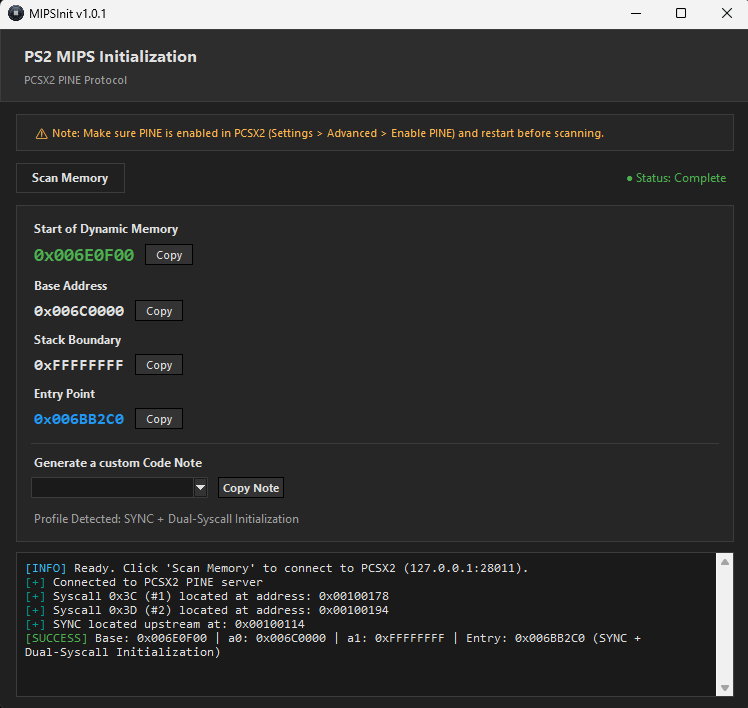

# MIPSInit

A standalone tool that hooks into the PCSX2 PINE debugger protocol which analyzes MIPS initialization routines, track memory allocation and map dynamic base addresses for PlayStation 2 titles.

---

## Features

* **PINE Debugger Hook:** Connects directly to PCSX2 debugger over local loopback (`127.0.0.1:28011`).
* **Initialization Scanning:** Scans MIPS architecture structures from the debugger for both standard and custom memory allocation setups.
* **Memory Address Mapping:** Tracks down dynamic base address, stack boundary and other memory blocks.
---



## How It Works

`MIPSInit` automates what used to be a tedious manual process which involves digging through static ELF headers "bytes @0x18" and manually inspect the debugger disassembly with the load address (e.g., `0x00100008`), to find the correct heap initialization block, the tool queries live memory via the PINE protocol to find these patterns instantly:
* **Opcode Tracking:** Inspects memory blocks for instruction patterns (such as `0x3c`, `0x3d`) associated with register loading and immediate values.
* **SYNC Stubs:** Isolates early hardware synchronization blocks and syscall chains for custom memory setups.

### Standalone Executable (Windows)
1. Download the latest `MIPSInit.exe` release from the [Releases](../../releases) section.
2. Launch PCSX2 with the PINE server enabled (Port `28011`).
3. Run `MIPSInit.exe` and start scanning. It will automatically attach to the processor and begin scanning.

### Running from Source
Requires Python 3.x and standard libraries.

```cmd
git clone https://github.com/AshMetalRaf/MIPSInit.git
```
```
cd MIPSInit
```
```
python app.py
```

## Building

To build the standalone `.exe` using PyInstaller:

```cmd
python -m PyInstaller --noconsole --onefile --name "MIPSInit" --icon="icon.ico" --add-data "icon.ico;." app.py
```
